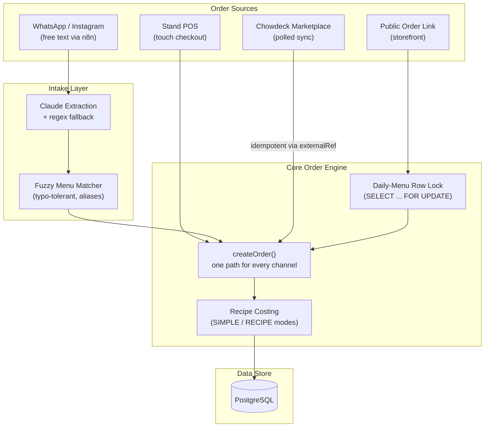

# Kitchen Crest — Multi-Channel Food Business Platform

An order intake, point-of-sale, recipe costing, and profit platform built for a Nigerian food business selling across a physical stand, WhatsApp, Instagram, a delivery marketplace, and a public order link — all feeding one shared kitchen, inventory, and ledger.

---

> **Notice**: The source code for this repository is private, as it is an active commercial product used daily by a live food business. This showcase covers the architecture, engineering decisions, and representative code. A live walkthrough is available on request.
>
> **Developer Contact**: Chibuike Okwor | malachiokwor@gmail.com | AI Automation Engineer & Full-Stack Developer

---

## 🎯 The Problem

A small food business was running order intake across five disconnected surfaces — a physical stand, phone calls, WhatsApp, Instagram DMs, and (later) a delivery marketplace — with no shared view of any of it:

1. **No single order book.** Orders lived in chat threads and memory. Nothing told staff what was promised, to whom, or by when.
2. **No real cost picture.** Sales were tracked, but food cost per dish wasn't, so "are we actually profitable" had no real answer.
3. **Limited-portion dishes oversold.** A dish cooked in a fixed batch for the day could be sold out on the stand and still get ordered online minutes later.
4. **Manual re-typing of WhatsApp orders.** Every DM order had to be read and manually re-entered into *something* before it reached the kitchen.
5. **A new marketplace channel (Chowdeck) with its own order feed**, disconnected from everything above.

## 💡 The Solution

One system all channels write into, so the kitchen, inventory, and the owner's numbers never disagree.

### Key Capabilities

- **Six order channels, one ledger**: Stand POS, phone/in-person, WhatsApp, Instagram, a public online order link, and Chowdeck marketplace sync — every order lands in the same table with the same cost/margin math.
- **AI-assisted order intake**: WhatsApp/Instagram messages (including Pidgin and casual English) are parsed into structured draft orders by Claude, with a deterministic regex/heuristic fallback when no AI key is set or the call fails — either way, every item name is re-validated against the live menu before a price is trusted.
- **Recipe costing & two profit modes**: Dishes are built from ingredient recipe lines with live per-portion cost; the owner can run "sales minus every expense" or full recipe-costed margin, switchable at any time without losing history.
- **Portion-limited daily menu with real concurrency control**: A dish capped at, say, 20 portions for the day is locked at the database row level during checkout, so a stand sale and an online order racing for the last portion are resolved one at a time, never both succeeding.
- **Chowdeck marketplace sync**: Orders placed through the Chowdeck delivery platform are pulled in on a schedule, mapped onto the same order/status model, and reconciled idempotently — re-running a sync never creates duplicates.
- **Stand POS mode**: A touch-first checkout for in-person sales, built for a tablet at a food stand, not a desktop form.
- **Native iOS/Android via Capacitor**, wrapping the live server (not a static export, since server actions and the database need a real backend) — with a CI pipeline that builds Android directly and compiles the iOS project on GitHub's macOS runners, so a release-ready pipeline exists without owning a Mac.
- **Staff accounts with PIN auth**, scrypt-hashed, with lockout after repeated failed attempts and a session-version bump that signs a staff member out of every device instantly.

---

## 👤 My Role & Contributions

Sole full-stack developer, end to end:

- **Data modeling**: Designed the PostgreSQL/Prisma schema — orders, channels, recipe lines, daily-menu availability, customers, and a kobo-integer money convention throughout to avoid floating-point currency bugs.
- **Concurrency-safe inventory**: Built the portion-limit locking logic (`SELECT ... FOR UPDATE`) so limited dishes can't be oversold when two channels check out at the same moment.
- **AI order-parsing pipeline**: Designed the Claude-based extraction layer and its non-AI fallback, plus the fuzzy menu-matching algorithm (typo-tolerant, alias-aware, confidence-scored) that grounds every AI-read item name back to a real menu price — the model never gets to invent a price.
- **Third-party marketplace integration**: Built the Chowdeck API client and idempotent sync engine from their merchant API docs, including defensive status mapping for statuses the integration hasn't seen before.
- **Mobile shipping pipeline**: Took the app from "responsive web" to installable native apps — PWA manifest and icons, safe-area/notch handling, Capacitor shells for iOS and Android, and a GitHub Actions workflow that builds both without local native tooling.
- **Security**: PIN hashing, session invalidation, rate-limited public order intake, and a from-scratch audit pass for mobile-specific issues (iOS input-zoom, tap-target sizing, safe-area insets).

---

## 🛠 Tech Stack

| Layer | Technology | Purpose |
| :--- | :--- | :--- |
| **Frontend Framework** | Next.js 16 (App Router), React 19 | Server Components, Server Actions, streaming UI |
| **Language** | TypeScript 5 | Strict typing across the whole stack |
| **Styling** | Tailwind CSS v4 | Shared component classes, dark-mode-aware tokens |
| **Database & ORM** | PostgreSQL, Prisma ORM, Supabase | Relational store, pooled connections, migrations |
| **AI** | Claude API (Anthropic) | Structured extraction of free-text orders, with a deterministic fallback |
| **Messaging** | Twilio (WhatsApp Business API) | New-order alerts to staff |
| **Marketplace Integration** | Chowdeck Merchant API | Polling order sync, mapped onto the internal order model |
| **Native Shell** | Capacitor | iOS/Android apps wrapping the live server |
| **CI/CD** | GitHub Actions | Web build/lint/typecheck + Android APK/AAB + iOS simulator build on macOS runners |
| **Hosting** | Vercel | Edge-adjacent deployment, cron-triggered marketplace sync |

---

## 📊 System Architecture & Order Flow

---

## 🤖 AI Engineering

Kitchen Crest ships a real, in-production AI feature, not a roadmap item:

- **Extraction, not generation**: Claude reads a WhatsApp/Instagram message and returns structured JSON (customer, items, fulfillment, due time) — it never decides a price. Every extracted item name is re-run through the menu-matching engine against the live database; the AI's job stops at "what did they probably mean."
- **Graceful degradation**: If `ANTHROPIC_API_KEY` isn't set, or the API call errors, a regex/heuristic parser takes over using the same matching engine — the intake pipeline degrades, it doesn't fail.
- **Confidence-scored, human-in-the-loop**: Every parse carries a confidence score; low-confidence or ambiguous matches are flagged `needsReview` with a reason, rather than silently guessing on a customer's order.

---

## 📸 Application Screenshots

*(Screenshots available on request — captured against seeded demo data only, never the live business's real orders or customers.)*

- **Today Dashboard**: At-a-glance view of today's orders, kitchen prep list, and alerts.
- **Orders List & Detail**: Multi-channel order book with status flow, payment tracking, and food-cost/margin breakdown per order.
- **Stand POS**: Touch-first checkout for in-person sales.
- **Menu & Recipe Builder**: Ingredient-level recipe lines with live portion cost and margin.
- **Profit Dashboard**: Daily revenue/cost chart and a per-channel breakdown (including Chowdeck).
- **Settings — Chowdeck Sync**: Manual and scheduled marketplace order sync.
- **Native Mobile View**: The Capacitor-wrapped app running as an installed iOS/Android app.

See [`screenshots/README.md`](./screenshots/README.md) for capture guidelines.

---

## 🔧 Engineering Challenges & Solutions

### 1. Preventing Oversold, Portion-Limited Dishes Across Channels
- **Challenge**: A dish capped at a fixed batch size for the day could be sold out on the stand and still accepted online seconds later, because two checkouts read "portions remaining" independently.
- **Solution**: Inside the order transaction, the relevant `DailyMenuItem` rows are locked with `SELECT ... FOR UPDATE` before the remaining-portion check runs, so two orders racing for the last plate are serialized rather than both reading a stale count. See [`snippets/daily-menu-locking.ts`](./snippets/daily-menu-locking.ts).

### 2. Trusting AI-Extracted Orders Without Trusting AI-Extracted Prices
- **Challenge**: An LLM reading "2 jollof n chicken, one zobo abeg" needs to become a priced order line — but an LLM should never be the source of truth for money.
- **Solution**: A typo-tolerant, alias-aware fuzzy matcher scores every extracted item name against the real menu (exact match → alias match → phrase containment → token-overlap with a one-edit typo allowance) and returns a confidence score; the price always comes from the matched database row, never from the model's output. See [`snippets/menu-match.ts`](./snippets/menu-match.ts).

### 3. Integrating a Third-Party Marketplace Without Breaking on Its Own Status Vocabulary
- **Challenge**: Chowdeck's own order statuses (`received`, `awaiting_pickup`, `rejected`, …) don't match the app's internal order lifecycle, and new/unexpected values should never crash a sync or get silently misrepresented.
- **Solution**: A small, explicit status-mapping function with a safe, flagged-for-review fallback for anything unrecognized, plus `externalRef`-keyed idempotency so re-running the sync only ever advances an order's status, never duplicates it. See [`snippets/chowdeck-sync.ts`](./snippets/chowdeck-sync.ts).

### 4. Shipping Native Apps for a Dynamic (Not Static) Next.js App, With No Local Mac
- **Challenge**: The app depends on server actions and a live database, so it can't be exported as static files for a Capacitor bundle — and compiling the iOS half of a Capacitor project normally requires Xcode on a Mac.
- **Solution**: Capacitor's native shells are configured to load the live deployed URL rather than bundled files, and a GitHub Actions workflow builds the Android APK/AAB directly on Linux runners while compiling (and, once signing secrets are added, archiving) the iOS project on GitHub's hosted macOS runners — a full native release pipeline with zero local native tooling.

---

## 📩 Contact & Inquiry

For architecture discussions, live code walkthroughs, or custom software development inquiries:

- **Developer**: Chibuike Okwor
- **Role**: AI Automation Engineer & Full-Stack Developer
- **Email**: malachiokwor@gmail.com
